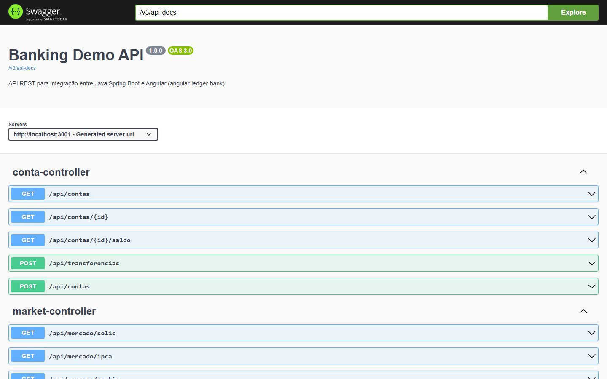
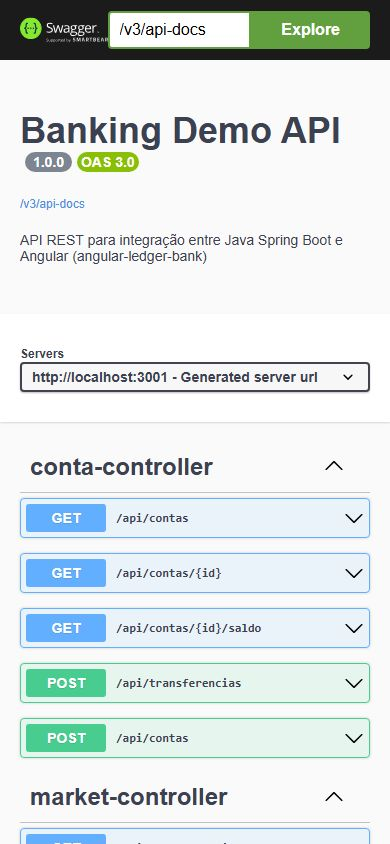

# Banking Demo Backend


Backend Java Spring Boot que simula operações bancárias, criado para demonstrar conhecimento em Java + Angular.

## Documentação da API (Swagger)

Documentação interativa gerada com **springdoc-openapi**:

- UI: [`http://localhost:3001/swagger-ui/index.html`](http://localhost:3001/swagger-ui/index.html)
- Especificação JSON: `http://localhost:3001/v3/api-docs`

### Screenshots

| Desktop | Mobile |
|---------|--------|
|  |  |

> Prints gerados por um teste E2E que sobe a aplicação e valida que o Swagger está publicado com todos os endpoints (ver `SwaggerE2ETest`).

<details>
<summary>Como regerar os prints</summary>

```bash
# 1. Suba a aplicação
mvnw.cmd spring-boot:run

# 2. Em outro terminal, capture as telas (requer Node.js + Playwright)
npx playwright screenshot --viewport-size=1440,900 http://localhost:3001/swagger-ui/index.html docs/screenshots/swagger-desktop.jpg
npx playwright screenshot --viewport-size=390,844  http://localhost:3001/swagger-ui/index.html docs/screenshots/swagger-mobile.jpg
```

</details>

## Endpoints Disponíveis

### Contas Bancárias
- `GET /api/contas` - Listar todas as contas
- `GET /api/contas/{id}` - Buscar conta por ID
- `GET /api/contas/{id}/saldo` - Consultar saldo
- `POST /api/contas` - Criar nova conta
- `POST /api/transferencias` - Realizar transferência entre contas

### Transações
- `GET /api/transacoes` - Listar transações
- `POST /api/transacoes` - Criar nova transação
- `GET /api/transacoes/{id}` - Buscar transação
- `PUT /api/transacoes/{id}` - Atualizar transação
- `DELETE /api/transacoes/{id}` - Excluir transação

### Dados de Mercado (APIs Reais)
- `GET /api/mercado/selic` - Taxa Selic (Banco Central)
- `GET /api/mercado/cambio` - Câmbio USD/BRL
- `GET /api/mercado/ipca` - IPCA (inflação)

### Health Check
- `GET /actuator/health` - Status da aplicação

## Como Rodar Localmente

### Pré-requisitos
- Java 21+
- Maven ou Maven Wrapper

### Com Maven Wrapper
```bash
# Linux/Mac
./mvnw spring-boot:run

# Windows
mvnw.cmd spring-boot:run
```

### Com Maven
```bash
mvn spring-boot:run
```

Servidor sobe em: `http://localhost:3001`

## Testes

### Testes Unitários e E2E
```bash
# Windows
mvnw.cmd test

# Linux/Mac
./mvnw test
```

A suíte cobre:
- **Unitários** (`ContaControllerTest`): regras do controller com Mockito.
- **E2E** (`SwaggerE2ETest`): sobe a aplicação em porta aleatória e valida
  Swagger/OpenAPI, health check e o endpoint de contas respondendo pela rede.

### Cobertura
```bash
mvn test jacoco:report
```

## Stack

- Java 21 (LTS)
- Spring Boot 3.1.5
- Spring Web
- Spring Actuator
- Maven
- APIs Externas: Banco Central, AwesomeAPI

## Deploy

### Railway
1. Push para GitHub
2. Conectar Railway ao repositório
3. Auto-detecta Spring Boot e inicia build
4. URL gerada automaticamente

### Render
1. Push para GitHub
2. Criar Web Service no Render
3. Build command: `mvn clean package`
4. Start command: `java -jar target/*.jar`

## Integração com Frontend Angular

Atualizar a URL da API no frontend:

```typescript
// environment.prod.ts
export const environment = {
  apiUrl: 'https://sua-url-deploy/api'
};
```

## Estrutura do Projeto

```
src/
├── main/
│   ├── java/com/banking/demo/
│   │   ├── SpringBootDemoApplication.java
│   │   ├── controller/
│   │   ├── service/
│   │   ├── model/
│   │   └── exception/
│   └── resources/
│       └── application.properties
└── test/
    └── java/com/banking/demo/
```

## Licença

MIT
